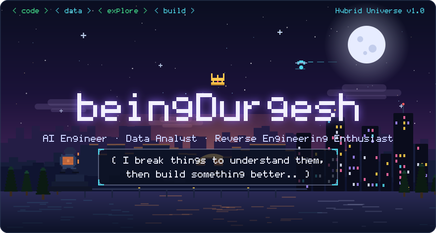
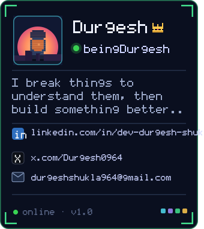
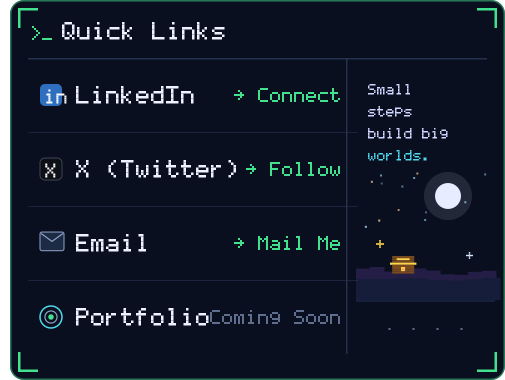
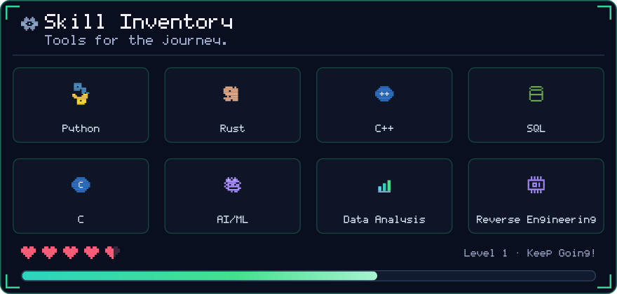
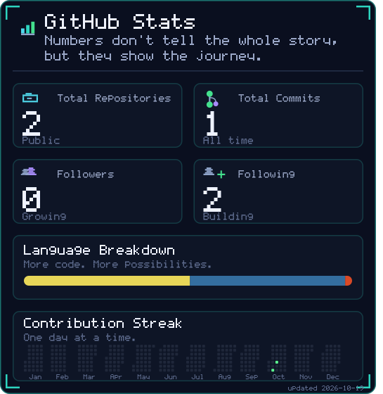
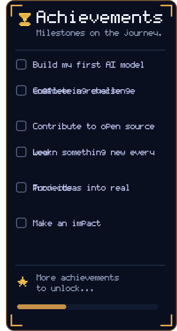
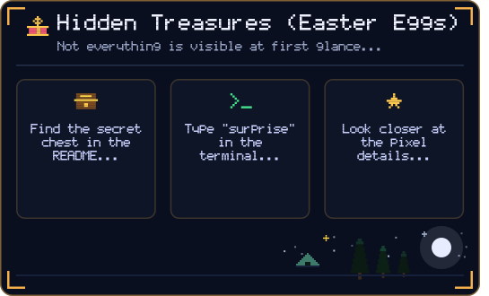
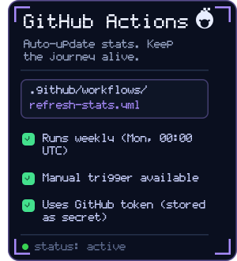
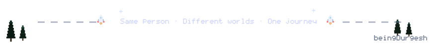

<!-- ══════════════════════════════════════════════════════════════════════ -->
<!--  beingDurgesh · Hybrid Universe v1.0                                  -->
<!--  Every panel below is an SVG in assets/ - no external dependencies.   -->
<!--  Stats auto-refresh weekly via .github/workflows/refresh-stats.yml    -->
<!--  Rebuild locally:  node scripts/generate.mjs                          -->
<!-- ══════════════════════════════════════════════════════════════════════ -->

<!-- 🧰 secret chest found — enjoy the pixel dust, explorer -->

<a href="https://www.linkedin.com/in/dev-durgesh-shukla/">LinkedIn</a> · <a href="https://x.com/Durgesh0964">X (Twitter)</a> · <a href="mailto:durgeshshukla964@gmail.com">Email</a> · Portfolio (coming soon)

